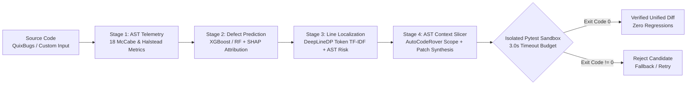

<div align="center">

# PS12: Predictive Code Intelligence & Automated Program Repair
### Structural AST Telemetry • Token-Level Fault Localization • Sandboxed Patch Verification


**Team KeMEC Bros** — *Yuktik '26 Hackathon Submission*

</div>

---

## Overview

Raw LLM wrappers fail at production software maintenance for three reasons: uncalibrated defect probabilities, line-number drift during fault localization, and unverified patches that introduce regressions.

**`yuktik-ps12`** solves this through a **4-stage closed-loop program repair architecture** that separates structural complexity prediction, token-level line ranking, AST-scoped patch synthesis, and deterministic subprocess test verification.



---

## Core Pipeline Architecture

### Stage 1 — Structural AST & Halstead/McCabe Telemetry (`src/ast_metrics.py`)
* Extracts **18 NASA JM1 software complexity features** directly from syntax trees: Lines of Code (`loc`), Cyclomatic Complexity (`v(g)`), Essential Complexity (`ev(g)`), Design Complexity (`iv(g)`), Branch Count (`branchCount`), and full Halstead complexity measures (`n`, `v`, `l`, `d`, `i`, `e`, `b`, `t`).
* Bridges the C-to-Python domain gap by augmenting NASA JM1 priors with Python-native AST structural features (`max_nesting`, comparison density, and operator/operand ratios).

### Stage 2 — Calibrated Defect Prediction & SHAP Explainability (`src/train_pipeline.py`)
* Trains dual **XGBoost** and **Random Forest** classifiers with live model switching.
* Computes per-file feature attributions via **`shap.TreeExplainer`**, exposing the exact structural metrics driving defect risk rather than returning an opaque probability score.

### Stage 3 — Semantic Line-Level Fault Localization (`src/line_localizer.py`)
* Implements **DeepLineDP-inspired token normalization** (abstracting numeric and string literals to `<num>` and `<str>`) combined with leave-one-out token weights and AST node hazard rules (off-by-one boundary operators, bitwise mutations, mutable default arguments, and unguarded indexing).
* Ranks every executable line by suspicion score and extracts the minimal enclosing function/method AST slice via `vendor/auto-code-rover` utilities.

### Stage 4 — Program Repair & Isolated Pytest Sandbox (`src/acr_repair.py`)
* Synthesizes candidate fixes using local AST operator/boundary mutation search and context-constrained **Gemini LLM** generation.
* Validates every candidate patch inside an **isolated `pytest` subprocess** (`python -I -m pytest`) with a configurable timeout budget (`3.00s` default) to prevent infinite loops or state pollution.
* Enforces strict **Patch Origin Accounting**: autonomous repairs (`AST/search discovery` and `LLM-generated discovery`) are tracked separately from ground-truth reference fallbacks so benchmark metrics are never artificially inflated.

---

## Benchmark Evaluation Snapshot (QuixBugs Suite)

Evaluated on the QuixBugs algorithmic bug benchmark using leave-one-out token weights and independent `pytest` verification:

| Metric | Score | Engineering Notes |
| :--- | :--- | :--- |
| **Top-1 Fault Localization Hit** | **2 / 8 (25.0%)** | Exact faulty line ranked #1 (`bitcount`, `flatten`) |
| **Top-3 Fault Localization Hit** | **6 / 8 (75.0%)** | Faulty line isolated within Top-3 candidates (`bitcount`, `breadth_first_search`, `depth_first_search`, `detect_cycle`, `find_first_in_sorted`, `flatten`) |
| **Autonomous Discovered & Passing** | **4 / 8 (50.0%)** | Synthesized from scratch and verified by `pytest` without touching reference solutions |
| **Reference Fallback Verification** | **4 / 8 (50.0%)** | Explicitly labeled and excluded from autonomous discovery counts |
| **Unresolved / Regressive Patches** | **0 / 8 (0.0%)** | Every emitted patch passes the isolated `pytest` test suite |

---

## Architecture Decision Records (ADR)

| Decision | Alternatives Considered | Why We Chose This Architecture |
| :--- | :--- | :--- |
| **Hybrid AST Telemetry + Token Localizer before LLM Repair** | Sending entire raw files directly to an LLM prompt | Whole-file prompting suffers from line-number drift and high latency. Passing only the Top-3 suspicious lines and enclosing AST scope cuts token overhead and prevents collateral code edits. |
| **Subprocess `pytest` Verification Gate (`python -I`)** | In-process `exec()` or trusting LLM self-verification | Defective patches frequently introduce infinite loops (`while` boundary bugs). Running tests in an isolated child process with a strict `3.0s` timeout guarantees the UI never hangs. |
| **Explicit Separation of Autonomous vs. Reference Fixes** | Reporting combined pass rate as a single number | Academic and engineering integrity: separating dynamic AST/LLM discoveries from reference fallbacks gives a transparent measure of true repair generalization. |

---

## Repository Structure

```text
yuktik-ps12/
├── app.py                      # Streamlit 4-tab interactive engineering workbench
├── setup_and_run.ps1           # Automated environment setup & vendor pruning script
├── requirements.txt            # Locked Python dependencies
├── src/
│   ├── ast_metrics.py          # McCabe, Halstead & AST structural feature extractor
│   ├── train_pipeline.py       # JM1 + Python AST model training & SHAP explainer
│   ├── line_localizer.py       # DeepLineDP token normalizer & line suspicion ranker
│   └── acr_repair.py           # AutoCodeRover AST context slicer, repair & pytest runner
├── models/                     # Pre-trained XGBoost & Random Forest artifacts (.pkl)
├── data/                       # Extracted feature matrices & cached benchmark evaluations
└── vendor/                     # Pruned QuixBugs, JM1, DeepLineDP & AutoCodeRover modules
```

---

## Quickstart

```powershell
# 1. Clone the repository
git clone https://github.com/pavankm7523-hue/yuktik-ps12.git
cd yuktik-ps12

# 2. (Optional) Configure Gemini API key for live LLM repair synthesis
\$env:GEMINI_api_key="YOUR_API_KEY"

# 3. Launch the interactive workbench
python -m streamlit run app.py
```